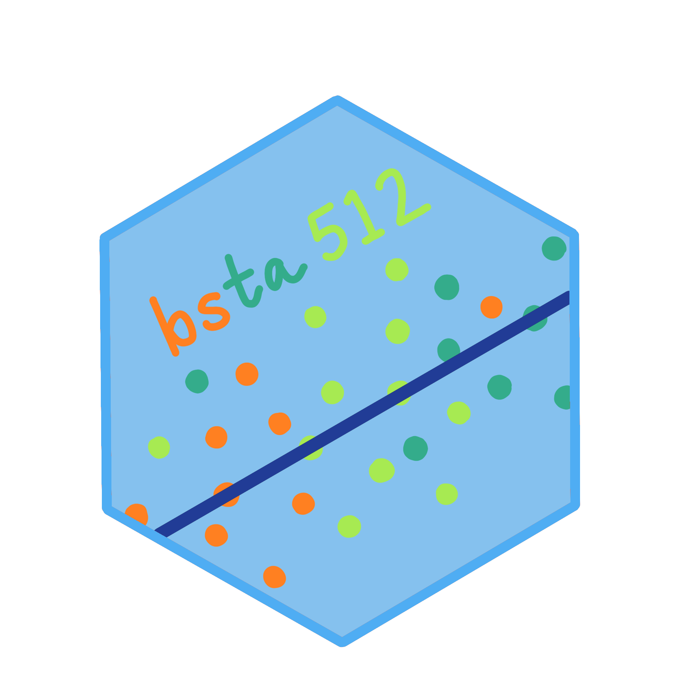

```{r setup, include=FALSE}
library(here)
source(here("class_dates.R"))
```

::: {.grid .hero}
::: {.g-col-12 .g-col-md-4}
{fig-align="center" width="337"}
:::

::: {.g-col-12 .g-col-md-8}
# BSTA 512/612: Linear Models

[Winter 2027]{.term-pill}

::: hero-text
**Welcome to BSTA 512/612!**

In this course, we will focus on linear models, and build our understanding of regression analysis. We will build some theoretical understanding in order to interpret and apply regression models appropriately. We will learn how to build a regression model, interpret the model, and diagnose potential issues with our model.
:::

[OneDrive Folder](https://ohsuitg-my.sharepoint.com/:f:/r/personal/wakim_ohsu_edu/Documents/Teaching/Classes/BSTA_512_26W/Student_BSTA_512?csf=1&web=1&e=KliyNt){.hero-btn} [Class Zoom](https://pdx.zoom.us/j/82300634081){.hero-btn} [Syllabus](syllabus.qmd){.hero-btn} [Schedule](schedule.qmd){.hero-btn}
:::
:::

::: cards-band
::: grid
::: {.g-col-12 .g-col-md-6 .g-col-lg-3}
::: {.info-card .card-orange}
### Instructor

[]{.icon} [Dr. Nicky Wakim](instructors.qmd)

[]{.icon} Vanport 622A

[]{.icon} [wakim\@ohsu.edu](mailto:wakim@ohsu.edu)
:::
:::

::: {.g-col-12 .g-col-md-6 .g-col-lg-3}
::: {.info-card .card-blue}
### Office Hours

**Nicky**

[]{.icon} [F 11 AM - 12 PM](https://pdx.zoom.us/j/88034032016)

**TAs**

TA office hours will be posted here.
:::
:::

::: {.g-col-12 .g-col-md-6 .g-col-lg-3}
::: {.info-card .card-pink}
### Course details

[]{.icon} Mondays, Wednesdays

[]{.icon} `{r} w1d1 %>% format("%m/%d")` - `{r} w11d1 %>% format("%m/%d")`

[]{.icon} 1:00 PM - 2:50 PM

[]{.icon} In-person, LH 339
:::
:::

::: {.g-col-12 .g-col-md-6 .g-col-lg-3}
::: {.info-card .card-green}
### Contacting me

[]{.icon} E-mail is the best way to reach me. I try to respond to all course-related e-mails within 24 hours, Monday-Friday.
:::
:::
:::
:::

::: source-link
[ View the source on GitHub](https://github.com/nwakim/BSTA_512_27W)
:::
