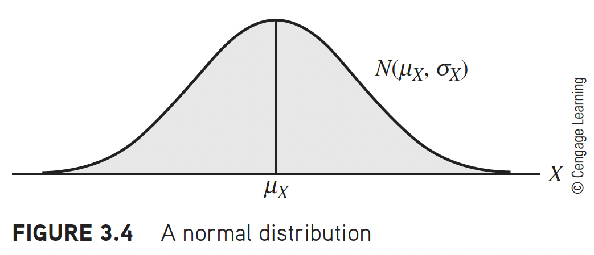
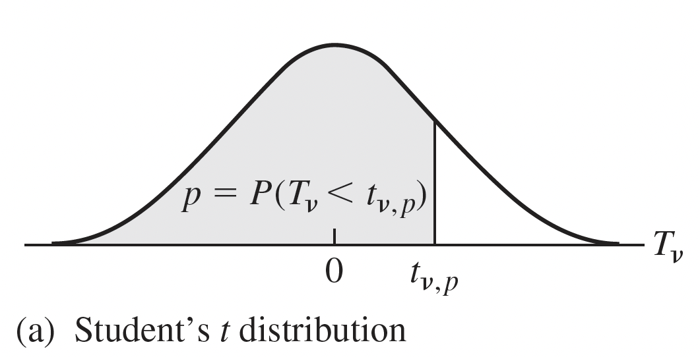
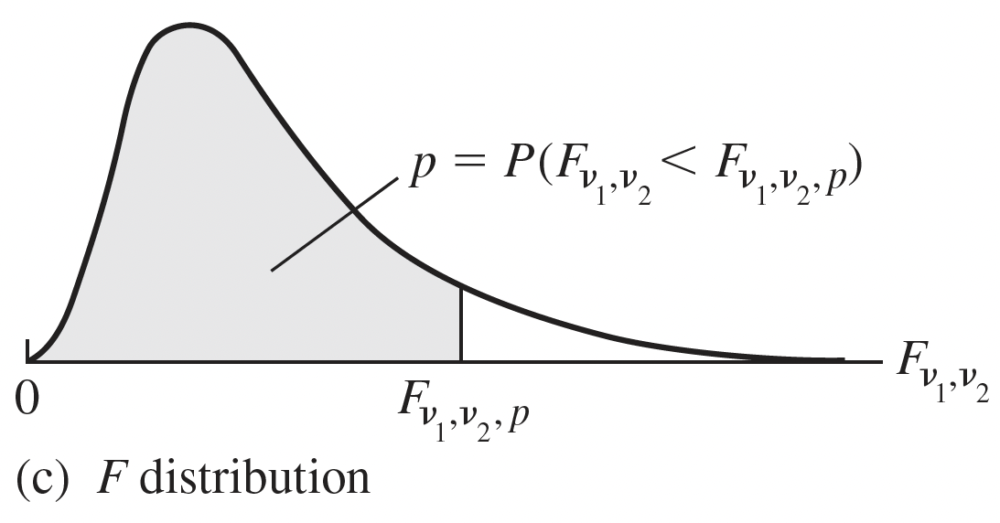
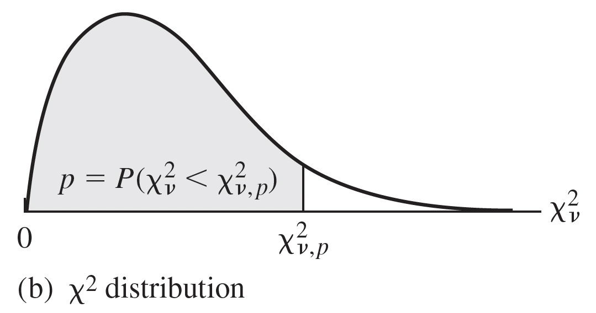
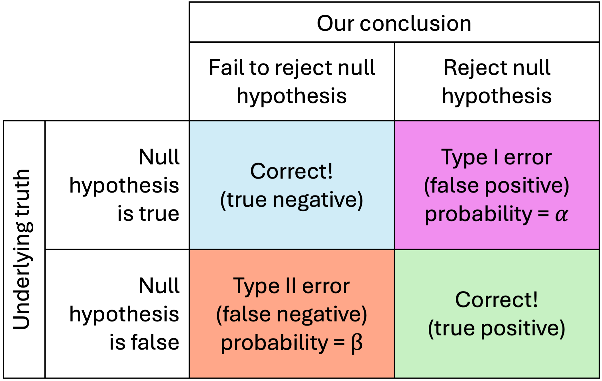

```{r}
#| label: "setup"
#| include: false
#| message: false
#| warning: false

library(tidyverse)
library(here)
library(gtsummary)
library(gt)
library(broom)

load(here("data", "dds.discr.rda"))  # dds.discr data from the oibiostat package
BodyTemps = read.csv(here("data", "BodyTemperatures.csv"))

set.seed(456)
```

## Learning Objectives

1.  Recognize the tools from 511/611 that we will keep using in 512/612

2.  Set up a class folder and R project, and load data with `here()`

3.  Use the core R functions we will need for homework and labs

## Learning Objectives

::: lob
1.  Recognize the tools from 511/611 that we will keep using in 512/612
:::

2.  Set up a class folder and R project, and load data with `here()`

3.  Use the core R functions we will need for homework and labs

## What did we learn in 511/611?

-   We had many good ways to assess the relationship between an outcome and *one* exposure:

|                      | Continuous Outcome                               | Categorical Outcome                                                                                              |
|----------------------|--------------------------------------------------|------------------------------------------------------------------------------------------------------------------|
| Continuous Exposure  | Correlation, simple linear regression            | ??                                                                                                               |
| Categorical Exposure | t-tests, paired t-tests, 2 sample t-tests, ANOVA | proportion test, Chi-squared goodness of fit test, Fisher's Exact test, Chi-squared test of independence, etc. |

: {tbl-colwidths="\[15, 35,35\]"}


-   **Those tests cannot handle more complicated data**

    -   What happens when other variables influence the relationship between your exposure and outcome?

-   Regression lets us handle many variables at once, but it is **built from the same pieces** you learned in 511

## Where 511 shows up in this class

| From 511/611                            | Where we will use it in 512/612                                             |
|-----------------------------------------|-----------------------------------------------------------------------------|
| Mean, SD, histograms, scatterplots      | Exploring our data before fitting any model (every lab!)                    |
| Correlation                             | Simple linear regression (Lesson 3)                                         |
| Normal distribution                     | Assumption about the errors in our model (Lesson 7)                         |
| t distribution                          | Tests and CIs for a single coefficient, $\beta$ (Lesson 4)                  |
| F distribution / ANOVA                  | ANOVA table and F-tests to compare models (Lessons 6 and 10)                |
| Confidence intervals, hypothesis tests  | Inference for our coefficients (all quarter)                                |
| Type I error and power                  | Testing many coefficients, model selection (Lessons 13 and 14)              |

: {tbl-colwidths="\[35, 65\]"}


-   You do not need to memorize formulas from 511, but these **ideas** will come back again and again

## Distributions we will use

::: columns
::: {.column width="50%"}
-   **Normal**: $Y\sim N(\mu,\sigma^2)$

    -   Our model assumes errors are Normal

-   **Student's t**: $T \sim t_{df}$

    -   Test and CI for one coefficient

-   **F**: $F \sim F_{df_1, df_2}$

    -   Test many coefficients at once (like ANOVA)
    -   Related to t: $T^2 \sim F_{1,\nu}$

-   **Chi-squared**: $X \sim \chi^2_{df}$

    -   Building block for the F distribution
:::

::: {.column width="50%"}
{width="45%"} {width="45%"}

{width="45%"} {width="45%"}
:::
:::

## R functions for probability distributions

-   Each distribution has a `p` function (probability) and a `q` function (quantile, or critical value)

| Distribution | Probability: $P(X \leq x)$  | Critical value          |
|--------------|-----------------------------|-------------------------|
| Normal       | `pnorm(x, mean, sd)`        | `qnorm(p, mean, sd)`    |
| t            | `pt(x, df)`                 | `qt(p, df)`             |
| F            | `pf(x, df1, df2)`           | `qf(p, df1, df2)`       |
| Chi-squared  | `pchisq(x, df)`             | `qchisq(p, df)`         |


::: columns
::: column
Critical value for a 95% CI with $n=10$:

```{r}
#| echo: true
qt(0.975, df = 9)
```
:::

::: column
$P(X > 2)$ when $X \sim N(4, 6^2)$:

```{r}
#| echo: true
1 - pnorm(2, mean = 4, sd = 6)
```
:::
:::

-   Use `lower.tail = FALSE` instead of `1 - ...` if you prefer

## Steps in a hypothesis test

1.  Check the [**assumptions**]{style="color:#4FADF3"}

2.  Set the [**level of significance**]{style="color:#4FADF3"} $\alpha$

3.  Specify the [**null**]{style="color:#4FADF3"} ( $H_0$ ) and [**alternative**]{style="color:#4FADF3"} ( $H_A$ ) [**hypotheses**]{style="color:#4FADF3"}

4.  Calculate the [**test statistic**]{style="color:#4FADF3"}

5.  Calculate the [**p-value**]{style="color:#4FADF3"}

6.  Write a [**conclusion**]{style="color:#4FADF3"} in the context of the problem


::: hl
These are the **same steps** we will use in 512! The only change is that our parameter will be a regression coefficient (like $\beta_1$) instead of a mean ( $\mu$ )
:::

## Example: one sample t-test with `t.test()`

::::: example
::: ex-title
Is the population mean body temperature different from 98.6°F?
:::

::: ex-cont
$H_0: \mu = 98.6$ vs. $H_A: \mu \neq 98.6$, with $\alpha = 0.05$
:::
:::::

```{r}
#| echo: true

temps_ttest = t.test(x = BodyTemps$Temperature, mu = 98.6)
tidy(temps_ttest) %>% gt() %>% tab_options(table.font.size = 36)
```


**Conclusion:** We reject the null hypothesis. The average body temperature was 98.25°F (95% CI 98.12, 98.38°F), which is discernibly different from 98.6°F ( $p$-value \< 0.001).

-   For two groups, use `t.test(x = grp1, y = grp2, var.equal = TRUE)`

## Type I error and power

::: columns
::: {.column width="55%"}
{fig-align="center"}
:::

::: {.column width="45%"}
-   **Type I error** ( $\alpha$ ): we reject $H_0$, but $H_0$ is true

-   **Power** ( $1-\beta$ ): we correctly reject $H_0$


-   This will matter when we run **many tests** on one model
:::
:::

## Learning Objectives

1.  Recognize the tools from 511/611 that we will keep using in 512/612

::: lob
2.  Set up a class folder and R project, and load data with `here()`
:::

3.  Use the core R functions we will need for homework and labs

## Folder organization

-   Make one folder for our class, like `BSTA_512_W27`

    -   On your computer, or in OneDrive **only if** you have the desktop app syncing it

::: columns
::: column
-   Inside it, I suggest:

    -   `Data`
    -   `Homework`
    -   `Lessons`
    -   `Project` (with `Code`, `Data_Raw`, `Data_Processed`, and `Reports` folders)
:::

::: column
-   Naming tips:

    -   Keep names short and relevant
    -   Use leading numbers for order (`01_`, `02_`)
    -   Use dates as "YYYY-MM-DD"
    -   Use `_` instead of spaces
:::
:::

## Create an R project

-   A project tells R where "home" is for our work


-   In RStudio: `File` → `New Project...` → `Existing Directory` → choose your `BSTA_512_W27` folder


-   Open the `.Rproj` file whenever you work on this class

    -   R will automatically start in that folder


-   **Only make one project for now!** You will use it for homework and labs

-   [5 minute video on R projects](https://rfortherestofus.com/2022/10/rstudio-projects)

## The `here` package

::: columns
::: column
-   A `.qmd` file looks for files starting in *its own* folder

    -   But our data is in the `Data` folder!

-   `here()` always starts at the folder with your `.Rproj` file

    -   Your code works on any computer, and for future you


```{r}
#| echo: true
#| eval: false
library(here)
here()   # shows your project folder
```
:::

::: column
](../img_slides/here_pkg.png){fig-align="center"}
:::
:::

## Loading data with `here()`

```{r}
#| echo: true
#| eval: false

library(readxl)
ch05q01 = read_excel(here("data", "CH05Q01.xls"))
BodyTemps = read.csv(here("data", "BodyTemperatures.csv"))
load(here("data", "dds.discr.rda"))
```


| Function       | Data file type    | Package needed |
|----------------|-------------------|----------------|
| `read_excel()` | `.xls`, `.xlsx`   | `readxl`       |
| `read.csv()`   | `.csv`            | Built in       |
| `load()`       | `.rda`, `.Rdata`  | Built in       |
| `read_sas()`   | `.sas7bdat`       | `haven`        |

## Learning Objectives

1.  Recognize the tools from 511/611 that we will keep using in 512/612

2.  Set up a class folder and R project, and load data with `here()`

::: lob
3.  Use the core R functions we will need for homework and labs
:::

## The pipe operator: `%>%`

-   The pipe lets us write steps in order: "take this, *then* do this, *then* do this"

::: heq
I want to find my keys, then start my car, then drive to work, then park my car.
:::

::: columns
::: {.column width="50%"}
**Nested**

```{r}
#| echo: true
#| eval: false
park(drive(start_car(find("keys")),
           to = "work"))
```
:::

::: {.column width="50%"}
**Piped**

```{r}
#| echo: true
#| eval: false
find("keys") %>%
  start_car() %>%
  drive(to = "work") %>%
  park()
```
:::
:::

-   You may also see `|>`, which works the same way for our purposes

## `glimpse()`: look at your data first

-   We will use the `dds.discr` dataset (from 511!) for examples

```{r}
#| echo: true
glimpse(dds.discr)
```

## `rename()` and `mutate()`: change and create variables

```{r}
#| echo: true
dds = dds.discr %>%
  rename(sex = gender, R_E = ethnicity) %>%           # new name = old name
  mutate(exp_1000 = expenditures / 1000,              # new variable from old
         age_sq = age^2)
glimpse(dds)
```

## `case_match()`: give numeric codes their category names

-   Many datasets (including our project data!) code categories as numbers

::: heq
In `mtcars`, `am` is `0` for automatic and `1` for manual. I want a variable with those names.
:::

```{r}
#| echo: true
mtcars = mtcars %>%
  mutate(transmission = case_match(am,
                                   0 ~ "automatic",
                                   1 ~ "manual"))
mtcars %>% select(am, transmission) %>% head(4)
```

-   **Always make a new variable name** so you keep the original

-   For conditions (like `age > 50`), use `case_when()` instead

## `fct_relevel()`: choose the reference category

-   When we put categorical variables in a model, one category is the **reference**

    -   R picks the first level (alphabetical by default)

```{r}
#| echo: true
levels(dds$sex)
dds = dds %>% mutate(sex = fct_relevel(sex, "Male"))
levels(dds$sex)
```


-   This will be very important in Lesson 5 (categorical covariates)!

## `filter()`, `select()`, and `drop_na()`

::: columns
::: column
`filter()` keeps **rows** that match a condition

```{r}
#| echo: true
dds %>%
  filter(age >= 50 & age <= 60) %>%
  nrow()
```


`drop_na()` removes rows with missing values

```{r}
#| echo: true
#| eval: false
dds %>% drop_na(age, expenditures)
```
:::

::: column
`select()` keeps (or drops) **columns**

```{r}
#| echo: true
dds %>%
  select(age, sex, expenditures) %>%
  head(4)
```
:::
:::

## `tbl_summary()`: make a "Table 1"

::: columns
::: {.column width="60%"}
-   From the `gtsummary` package

-   You will need this for your labs and poster!

```{r}
#| echo: true
#| eval: false

dds %>%
  select(age, sex, R_E, expenditures) %>%
  tbl_summary(
    label = list(age ~ "Age",
                 sex ~ "Sex",
                 R_E ~ "Race/Ethnicity",
                 expenditures ~ "Expenditures"),
    statistic = list(all_continuous() ~ "{mean} ({sd})"))
```
:::

::: {.column width="40%"}
```{r}
#| echo: false

dds %>%
  select(age, sex, R_E, expenditures) %>%
  tbl_summary(
    label = list(age ~ "Age",
                 sex ~ "Sex",
                 R_E ~ "Race/Ethnicity",
                 expenditures ~ "Expenditures"),
    statistic = list(all_continuous() ~ "{mean} ({sd})"))
```
:::
:::

## `ggplot()`: one variable

-   Histogram of a continuous variable, with labels ready for a report

```{r}
#| echo: true
#| fig-align: center
#| fig-height: 4
#| fig-width: 8

ggplot(data = dds, aes(x = age)) +
  geom_histogram(binwidth = 5) +
  labs(x = "Age (years)", y = "Count",
       title = "Distribution of age in sample") +
  theme(text = element_text(size = 20))
```

## `ggplot()`: two variables (a sneak peek at regression!)

```{r}
#| echo: true
#| fig-align: center
#| fig-height: 4.5
#| fig-width: 9

ggplot(data = dds, aes(x = age, y = exp_1000)) +
  geom_point() +
  geom_smooth(method = "lm", se = FALSE) +       # adds the best fit line
  labs(x = "Age (years)", y = "Expenditures ($1000s)",
       title = "Expenditures vs. age") +
  theme(text = element_text(size = 20))
```

## Functions to keep handy

| Function                          | Package      | What it does                                     |
|-----------------------------------|--------------|--------------------------------------------------|
| `here()`                          | `here`       | Builds file paths from your project folder       |
| `read_excel()`, `read.csv()`, `load()` | `readxl`, base | Loads data                                |
| `glimpse()`                       | `dplyr`      | Quick look at variables and types                |
| `rename()`, `mutate()`            | `dplyr`      | Rename and create variables                      |
| `case_match()`, `case_when()`     | `dplyr`      | Recode values into categories                    |
| `fct_relevel()`                   | `forcats`    | Set the reference category                       |
| `filter()`, `select()`, `drop_na()` | `dplyr`, `tidyr` | Keep rows, keep columns, drop missing       |
| `tbl_summary()`                   | `gtsummary`  | Table 1                                          |
| `ggplot()`                        | `ggplot2`    | Plots                                            |
| `pnorm()`, `qt()`, `t.test()`     | base         | Probabilities, critical values, t-tests          |


-   Next week we add `lm()` and `tidy()` to fit and look at regression models

## Resources

-   [More `dplyr` functions](https://dplyr.tidyverse.org/reference/index.html) (you'll need this for HW 1!)

-   [Online textbook: intro to data science](https://hellodata.science/)

-   [Meike's BSTA 511 page](https://niederhausen.github.io/BSTA_511_F25/) and [Nicky's EPI 525 page](https://nwakim.github.io/EPI_525_25F/) to review 511 topics

-   [Meike's R programming class (BSTA 526)](https://niederhausen.github.io/BSTA_526_W26/) for more R practice

-   [UCLA: which test and R code for 511 tests](https://stats.oarc.ucla.edu/r/whatstat/what-statistical-analysis-should-i-usestatistical-analyses-using-r/)

-   Basic Quarto set up: see the R recordings in OneDrive and my [EPI 525 site](https://nwakim.github.io/EPI_525_25F/)

## Do your exit ticket!!

- Don't forget to go online and fill it out!

  - This will count as your attendance


- I look forward to the quarter with you!
